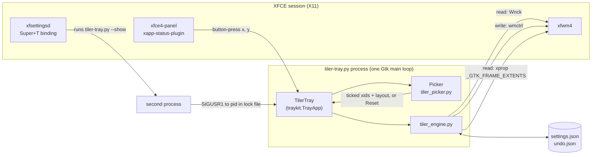

# Architecture

How the tiler is put together and how a click becomes moved windows. Terms are defined in
[DOMAIN.md](DOMAIN.md); the reasons behind each choice are in [DECISIONS.md](DECISIONS.md).

_Last updated: 2026-11-01T18:07:35+00:00 (files and process model for --service)._

## Component diagram



## Service boundaries

| Component | Owns | Never does |
|---|---|---|
| `traykit.py` | Status icon registration, label and icon quirks, single instance lock, menu rebuild, optional worker thread | Anything about windows |
| `tiler-tray.py` | The icon drawing, right-click menu, settings file, notifications, `--show` signalling | Moves windows itself |
| `tiler_picker.py` | The pop-up: list, ticks and their order, search, header icons, layout bar, keys, its own placement | Talks to the window manager beyond listing windows |
| `tiler_engine.py` | Layout maths (`rects`, pure), listing, tile, reset, undo, the undo file | Any UI |

The engine is importable on its own and has a CLI, which is how it is tested.

## Data flow

### Opening the pop-up

1. A left click on the status icon: the panel sends `button-press-event` with the point
   where a menu would go. traykit calls `TilerTray.primary_click(x, y, time)`.
   Super+T instead runs `tiler-tray.py --show`, which reads the pid from the lock file,
   checks that process is `tiler-tray.py`, and sends it `SIGUSR1`.
2. `Picker.__init__` reads the window list once (`list_windows`), builds every widget,
   hides what is not needed yet, measures, moves, and only then maps and presents the
   window. Mapping before that caused a visible flash (ROADMAP row 17).
3. The pop-up closes on Esc, a second icon click, or losing focus (checked 150ms later so
   the focus shuffle while mapping does not close it).

### Tiling

```mermaid
sequenceDiagram
    participant P as Picker
    participant T as TilerTray
    participant E as tiler_engine.tile
    participant W as xfwm4
    P->>P: close, wait 60ms
    P->>T: on_tile(xids, layout)
    T->>E: tile(xids, layout, gap)
    E->>E: snapshot to undo.json
    E->>W: leave full screen, unmaximize, move workspace, unminimize
    E->>E: settle (up to 500ms)
    E->>E: rects() for the work area of window 1's monitor
    E->>W: wmctrl -e per window, slot grown by its drawn shadow
    E->>W: raise in reverse order, window 1 last
    E->>E: settle (up to 400ms); place again if a shadow appeared
    E-->>T: tiled, stuck, gone
    T->>T: notify if stuck or gone, save last layout, rebuild menu later
```

Placement arithmetic for one window, slot `(x, y, w, h)`:

```
drawn shadow   (sl, sr, st, sb) from _GTK_FRAME_EXTENTS, zeros if absent
slot grown     (x - sl, y - st, w + sl + sr, h + st + sb)
WM frame       (fl, ft, fr, fb) = frame geometry minus client geometry, read after unmaximize
wmctrl -e      0, x - sl, y - st, (w + sl + sr) - fl - fr, (h + st + sb) - ft - fb
```

`wmctrl -e` with gravity 0 takes the frame's top left and the client's size; that is why
the WM frame is subtracted from the size but not from the position.

### Reset all

Snapshot to `undo.json`, leave full screen, maximize every listed window, settle, then
minimize each. One notification says how to undo.

### Undo

Read `undo.json`; for each window still open: leave full screen, unmaximize, unminimize if
it was visible, return it to its workspace, settle, place it at the saved frame position
and client size, then reapply maximized, full screen and minimized state. Delete the file.

## Process model

- One process, one Gtk main loop. traykit's worker thread runs once at start and returns
  nothing, because nothing is polled.
- Tile, reset and undo run on the main loop. They block it for at most about 1.3 seconds
  (three settle waits), which only matters if the pop-up were open, and it is closed by then.
- Menu rebuilds after an action are deferred 300ms: rebuilding inside a menu item's handler
  segfaulted (ROADMAP row 8).
- The tray has one menu for its whole life. A rebuild renders into a scratch menu and
  traykit copies it onto the live one, editing rows in place; check and radio items are
  swapped within the menu and destroyed one rebuild later (DECISIONS D17, ROADMAP row 26).
- Installed with `--service`, the process runs under systemd as `tiler-tray.service`, which
  starts it again 3 seconds after a crash (DECISIONS D18).

## Files

| File | Written by | Holds |
|---|---|---|
| `~/.config/tiler-tray/settings.json` | tray | gap, all workspaces, last layout |
| `~/.local/share/tiler-tray/undo.json` | engine | one snapshot: xid, title, geometry, states, workspace per window |
| `~/.local/share/tiler-tray/tiler.lock` | traykit | pid of the running tray |
| `~/.local/share/tiler-tray/tiles.png`, `tiler-icon-{0,1}.png` | tray, traykit | the icon, and its alternating copies |
| `~/.config/autostart/tiler-tray.desktop` | `install.sh` | autostart entry; with `--service` it starts the unit below |
| `~/.config/systemd/user/tiler-tray.service` | `install.sh --service` | systemd user unit that restarts the tray after a crash (DECISIONS D18) |

All writes to the two JSON files go to a temp file first, then `os.replace`.

## External dependencies

| Dependency | Used for |
|---|---|
| PyGObject, Gtk 3, Gdk | pop-up, monitor work areas, main loop |
| Wnck 3 | listing windows, reading geometry and state, minimize and unminimize |
| XApp status icon | the panel icon (Linux Mint's `xapp-status-plugin`) |
| `wmctrl` | moving and resizing, maximize and full screen state, workspaces, raising |
| `xprop` | reading `_GTK_FRAME_EXTENTS` |
| Pillow | drawing the icon once |
| `notify-send` | notifications |
| `xfconf-query`, `xfsettingsd` | the Super+T binding (install time only) |

## Scaling considerations

The tiler is a desktop utility; the limits are on screen, not in compute.

- Each window costs about four short subprocesses per tile (`wmctrl` state, `xprop`,
  `wmctrl -e`, `wmctrl -a`). At 9 windows that is still well under the settle waits.
- Layouts stay readable up to roughly 9 windows on a 1080p screen; beyond that app minimum
  sizes start to win (see [LIMITATIONS.md](LIMITATIONS.md)).
- The window list is read once per open, so a desktop with many windows costs nothing
  while the pop-up is closed.
