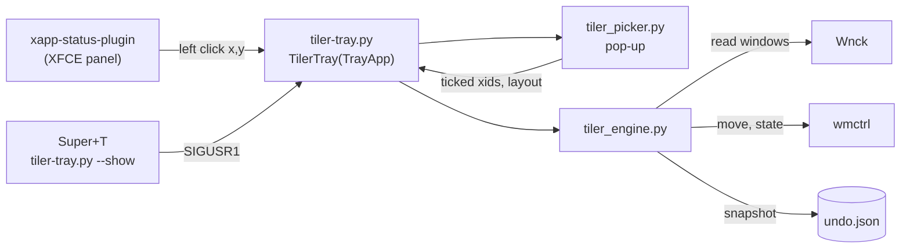

# Linux Mint XFCE Window Tiler

Tick the windows you want, pick a layout, done. A panel pop-up for Linux Mint XFCE that
tiles a chosen set of open windows side by side, stacked, in a grid, or as one main window
plus a side column.


_Last updated: 2026-11-01T18:07:35+00:00 (0.3.0: install.sh --service)._

**Status:** works on Linux Mint 22 XFCE (Xfce 4.18, xfwm4) under X11 with one 1080p
monitor. Two monitors, HiDPI scaling and Wayland are untested; see
[LIMITATIONS.md](LIMITATIONS.md) and [ROADMAP.md](ROADMAP.md).

## Contents

- [Overview](#overview)
- [Features](#features)
- [Using it](#using-it)
- [Architecture](#architecture)
- [Tech stack](#tech-stack)
- [Installation](#installation)
- [Configuration](#configuration)
- [Command line](#command-line)
- [Deployment and upgrades](#deployment-and-upgrades)
- [Security and performance](#security-and-performance)
- [Project structure](#project-structure)
- [Testing](#testing)
- [Roadmap](#roadmap)
- [Contributing](#contributing)
- [License](#license)
- [Acknowledgements](#acknowledgements)

## Overview

[X-Tile](https://www.giuspen.net/x-tile/) can tile windows on XFCE, but its command line
only tiles **all** open windows, and its tray mode opens a full application window. This
project is a small pop-up in the panel's status icon area that works on exactly the
windows you tick, in the order you tick them, and puts everything back with one Undo.

## Features

| Feature | Detail |
|---|---|
| Panel icon | Three panes drawn in light ink, no text. Hover: `Tile windows  \|  Super+T` |
| Pop-up | 360px wide, opens under the icon. Closes on Esc, a second click on the icon, or clicking anywhere else |
| Window list | Normal windows on the current workspace, most recently used first. Icon, title, app name. Minimized windows are dimmed and still selectable |
| Order by ticking | Each tick shows its position number at the right of the row. Window 1 goes left or top and ends up focused |
| Layouts | **Side by side**, **Stacked**, **Grid** (3 or more), **Main + side** (window 1 takes 60% on the left). The bar appears once 2 windows are ticked; each button draws the result |
| Header icons | Icon only, name and description in the tooltip: **Select all**, **Clear**, and, set apart, **Reset all** (circular arrow), which maximizes every listed window, then minimizes them all, for a clean desk. Undoable |
| Search | A filter box appears when 9 or more windows are listed |
| Tiling | Leaves full screen, unmaximizes, restores minimized windows, moves them to the current workspace, fits them below the panel, allows for each window's title bar and for the invisible shadow Chromium browsers and GTK header bar apps draw round themselves |
| Undo | Right click the icon, **Undo last tile or reset**. Restores position, size, maximized, minimized and full screen state, and workspace. One level |
| Warnings | A notification names any window that refused to shrink (an app minimum size), and counts windows closed before tiling |
| Keyboard | Super+T opens it. Up/Down move, Space ticks, 1 to 9 tick row n, Enter applies the last layout used, Esc closes |
| Settings | Right click: gap between windows (none, 4, 8, 16 px), list windows from all workspaces |

## Using it

1. Click the three-pane icon in the panel, or press **Super+T**.
2. Tick the windows in the order you want them placed.
3. Click a layout. The highlighted one is the last you used; Enter applies it.
4. For a clean desk instead, click the circular arrow at the top right, **Reset all**.
5. Changed your mind: right click the icon, **Undo last tile or reset**.

## Architecture



| Component | Role |
|---|---|
| `tiler-tray.py` | Status icon, right-click menu, settings, notifications. Subclasses `TrayApp`, turns polling off and takes left clicks itself |
| `tiler_picker.py` | The pop-up: list, tick numbering, search, header icons, layout bar, keys, placement under the icon |
| `tiler_engine.py` | `rects()` is pure layout maths. `list_windows()`, `tile()`, `reset()` and `undo()` talk to the window manager |
| `traykit.py` | Small scaffolding for XApp status icons: registration, single instance lock, menu rebuild, worker thread |

Windows are **read** through Wnck and **moved** through `wmctrl -e`, which lands to the
pixel under xfwm4 where `Wnck.Window.set_geometry` does not (DECISIONS D2). Each slot is
grown by any shadow the app draws inside its own window, so the visible part fills it
(D15).

Full data flow, placement arithmetic, process model and file list:
[ARCHITECTURE.md](ARCHITECTURE.md). Terms such as frame, drawn shadow and slot:
[DOMAIN.md](DOMAIN.md).

## Tech stack

| Piece | Package | Used for |
|---|---|---|
| `/usr/bin/python3` with PyGObject | `python3-gi` | everything |
| Gtk 3, Wnck 3 | `gir1.2-wnck-3.0` | pop-up; reading windows |
| XApp status icon | `gir1.2-xapp-1.0` | the panel icon |
| `wmctrl` | `wmctrl` | moving windows and changing their state |
| `xprop` | `x11-utils` | reading drawn-shadow sizes |
| Pillow | `python3-pil` | drawing the icon |
| `notify-send` | `libnotify-bin` | notifications |

Tested with the versions Linux Mint 22 ships. The panel must show XApp status icons, which
Linux Mint XFCE does out of the box (`xapp-status-plugin`).

## Installation

```bash
sudo apt install wmctrl x11-utils gir1.2-wnck-3.0 gir1.2-xapp-1.0 python3-pil libnotify-bin
git clone https://github.com/PalWorks/linux-mint-xfce-window-tiler.git
cd linux-mint-xfce-window-tiler
./install.sh            # symlinks, autostart, Super+T, starts the tray
./install.sh --service  # the same, plus a restart after any crash (recommended)
./install.sh --remove   # undoes all of that and stops the tray
```

`install.sh` checks the dependencies, is safe to run again, and:

1. Symlinks the scripts from `src/` into `TILER_BIN_DIR`, default
   `~/.local/lib/tiler-tray`. Keep the clone; the symlinks point into it.
2. Writes `~/.config/autostart/tiler-tray.desktop` and validates it.
3. Binds Super+T, unless Super+T is already bound to something else, and reloads
   `xfsettingsd` so the new key is live.
4. Starts the tray.

With `--service` it also writes the systemd user unit `~/.config/systemd/user/tiler-tray.service`,
points the autostart entry at it, and starts the tray through it. systemd then brings the
tray back 3 seconds after a crash; Quit from the menu and logging out stop it as usual.
Later runs of `./install.sh` keep the service; `./install.sh --no-service` goes back to a
plain launch.

If you already run other traykit-based trays, point `TILER_BIN_DIR` at their folder to
share one `traykit.py`. The installer will not overwrite a real `traykit.py`, and refuses
one too old to have `left_click_menu`.

Start and stop by hand (`BIN` is your `TILER_BIN_DIR`):

```bash
BIN=~/.local/lib/tiler-tray
/usr/bin/python3 $BIN/tiler-tray.py &                # refuses if already running
pkill -f "^/usr/bin/python3 $BIN/tiler-tray.py"
```

Keep the `^`: unanchored, the pattern also matches the shell running the command.

Installed with `--service`, use systemd instead:

```bash
systemctl --user restart tiler-tray.service
systemctl --user stop tiler-tray.service
journalctl --user -u tiler-tray.service     # starts, crashes and restarts
```

Always use `/usr/bin/python3`. A Homebrew or pyenv `python3` earlier on `PATH` usually
has no `gi` bindings.

## Configuration

| What | Where | Default |
|---|---|---|
| Gap, all workspaces, last layout | `~/.config/tiler-tray/settings.json`, set from the right-click menu | `0`, `false`, `side` |
| Undo snapshot | `~/.local/share/tiler-tray/undo.json`, deleted once used | none |
| Icon | `~/.local/share/tiler-tray/tiles.png`, drawn on first start. Delete it to redraw | |
| Lock file | `~/.local/share/tiler-tray/tiler.lock`, holds the running pid | |
| Main window share | `MAIN_SHARE` in `tiler_engine.py` | `0.6` |
| Search box threshold | `SEARCH_FROM` in `tiler_picker.py` | `9` |

## Command line

The engine runs on its own, which is how it is tested:

```bash
BIN=~/.local/lib/tiler-tray
/usr/bin/python3 $BIN/tiler_engine.py --list            # xid, app, title
/usr/bin/python3 $BIN/tiler_engine.py --list --all      # every workspace
/usr/bin/python3 $BIN/tiler_engine.py --layout side 0x04400003 0x04600003 --gap=8
/usr/bin/python3 $BIN/tiler_engine.py --reset 0x04400003 0x04600003
/usr/bin/python3 $BIN/tiler_engine.py --undo
```

`--layout` prints `{"tiled": [...], "stuck": [...], "gone": 0}`.

## Deployment and upgrades

This is a per-user desktop utility; there is no server and nothing to deploy beyond
`install.sh`.

```bash
cd linux-mint-xfce-window-tiler
git pull                      # the installed symlinks point into this clone
pkill -f "^/usr/bin/python3 $HOME/.local/lib/tiler-tray/tiler-tray.py"
./install.sh                  # restarts the tray and picks up any new files; keeps --service
```

To pin a version, `git checkout vX.Y.Z` instead of `git pull`. Rolling back is the same
with an older tag; see [PLAYBOOK.md](PLAYBOOK.md). Moving or deleting the clone breaks the
symlinks, so run `./install.sh --remove` first.

## Security and performance

- No network access, no root, no credentials. It writes only under your home folder.
  Details and how to report a vulnerability: [SECURITY.md](SECURITY.md).
- `undo.json` holds the titles of the windows last tiled or reset, which can include
  email addresses or document names. It stays local and is deleted once used.
- Nothing runs in the background: the window list is read when the pop-up opens. A tile
  blocks the tray for at most about 1.3 seconds while it waits for the window manager.

## Project structure

```
README.md            this file
AGENTS.md            rules for coding agents; CLAUDE.md points to it
ARCHITECTURE.md      components, data flow, placement arithmetic, files
DOMAIN.md            terms and rules
LIMITATIONS.md       known limits and what to do about them
PLAYBOOK.md          build, add a layout, debug, release, roll back
REQUIREMENTS.md      requirements R1 to R12 and where each is met
DECISIONS.md         why things are the way they are
ROADMAP.md           open items and the ledger
CHANGELOG.md         what changed when
TESTING.md           how it was verified, how to re-run
RUNBOOK.md           when something goes wrong
SECURITY.md          what it touches, how to report a problem
CONTRIBUTING.md      how to contribute, and the licence grant that requires
COMMERCIAL-LICENSE.md  the paid licence alternative to AGPL
LICENSE              GNU AGPL 3.0
install.sh           wire into the machine; --service, --no-service, --remove
src/
  tiler-tray.py      tray app
  tiler_picker.py    pop-up
  tiler_engine.py    maths and window moves
  traykit.py         status icon scaffolding
  tiler-tray.desktop autostart template
  tiler-tray.service systemd user unit template, for install.sh --service
tests/
  test_layouts.py    layout maths, no X needed
  test_roadmap.py    ROADMAP.md stays consistent
```

## Testing

```bash
/usr/bin/python3 -m unittest discover -s tests -v
```

Layout maths and a ROADMAP consistency check, no X needed. Live behaviour is verified on
throwaway windows; the list and results are in [TESTING.md](TESTING.md).

## Roadmap

See [ROADMAP.md](ROADMAP.md): trials on Electron and Chromium-based apps, then two
monitors and HiDPI.

## Contributing

See [CONTRIBUTING.md](CONTRIBUTING.md). Contributions need the licence grant described
there, because the project is dual licensed.

## License

Dual licensed:

- **[GNU Affero General Public License 3.0](LICENSE)** (`AGPL-3.0-only`), free, for anyone
  who accepts its terms, including sharing the source of modified versions you distribute
  or offer over a network.
- **A paid commercial licence** for use without the AGPL obligations. See
  [COMMERCIAL-LICENSE.md](COMMERCIAL-LICENSE.md).

## Acknowledgements

X-Tile by Giuseppe Penone and Chris Camacho, the tiler that showed what was missing.
libwnck and wmctrl, which do the real work.
